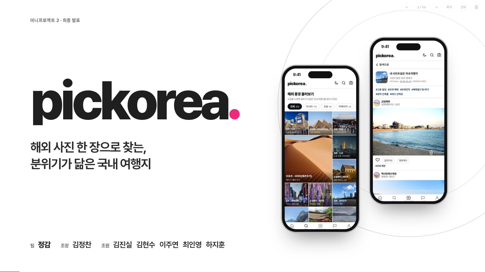
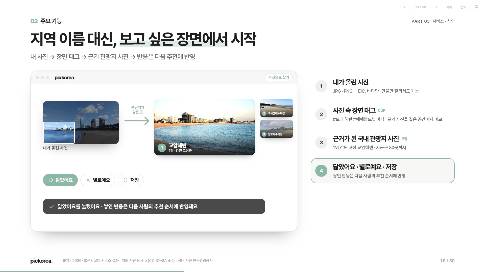
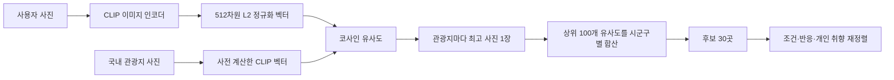
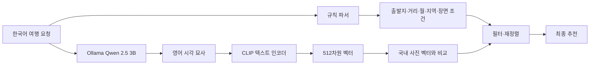
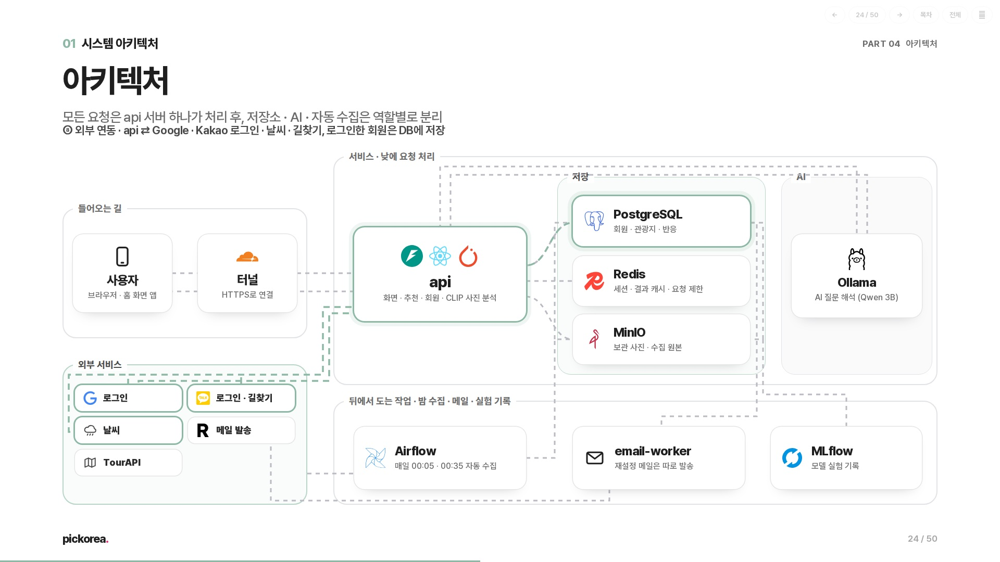
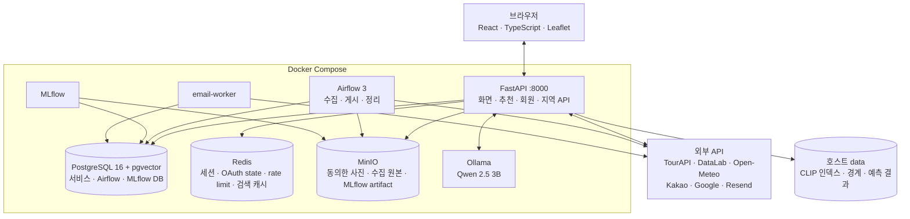

# pickorea

> 해외에서 본 장면과 닮은 국내 여행지를 사진과 문장으로 찾는 AI 여행 추천 서비스



해외 여행 사진을 올리면 CLIP이 분위기가 비슷한 국내 관광지 사진을 찾고, 관광지별 유사도를 시군구 단위로 모아 추천한다. 문장으로 검색할 때는 로컬 LLM이 한국어 요청을 영어 시각 묘사로 바꾸고, 지역·거리·시기 같은 조건은 규칙으로 검증해 적용한다.

추천에서 끝나지 않고 혼잡도, 날씨, 예상 경비, 음식점, 활동, 축제, 공식 여행코스까지 한 흐름에서 제공한다.

## 핵심 기능

| 기능 | 설명 |
|---|---|
| 사진으로 찾기 | 해외 사진 업로드·관심 영역 자르기·닮은 국내 시군구 최대 30곳 추천 |
| AI 여행 | “수원에서 가까운 조용한 바다”처럼 자연어로 검색 |
| 지역 상세 | 12개월 혼잡도, 날씨, 경비, 읍면동 먹거리, 관광지·축제·코스 |
| 개인화 | 저장·닮았어요·별로예요를 이용해 후보 30곳 안에서 순서 조정 |
| 계정 | 이메일·Google·Kakao 로그인, 프로필, 기본 출발지, 탈퇴 |
| 데이터 운영 | Airflow 수집, PostgreSQL 게시, MinIO 원본 보관, MLflow 실험 추적 |



## 추천 방식

### 사진 검색



사용 모델은 `openai/clip-vit-base-patch32`다. 별도 파인튜닝 없이 이미지와 텍스트가 공유하는 512차원 공간을 사용한다.

1. 국내 관광지 사진은 미리 벡터화해 `emb_kr.npz`에 저장한다.
2. 사용자 사진은 요청 시 같은 이미지 인코더로 벡터화한다.
3. 정규화 벡터의 내적으로 코사인 유사도를 계산한다.
4. 관광지마다 가장 닮은 사진 한 장을 남긴다.
5. 상위 100개 관광지 점수를 시군구별로 합산해 후보 30곳을 만든다.
6. 사진 유사도를 주 신호로 유지하면서 조건·반응·취향으로 후보 순서만 조정한다.

### 문장 검색



LLM은 장소를 직접 고르지 않는다. 영어 풍경 묘사를 만드는 역할만 맡는다. 출발지·월·거리·지역·바다·산·도시 같은 조건은 원문에서 확인되는 값만 규칙으로 추출해 적용한다. Ollama가 꺼지면 규칙 기반 경로로 동작한다.

## 검증 결과

| 평가 | 결과 | 해석 범위 |
|---|---|---|
| 사진 추천 개발셋 23곳 | Hit@5 57%, Hit@10 74% | 이 데이터로 집계 방식을 선택했으므로 낙관적일 수 있음 |
| 당시 홀드아웃 15곳 | Hit@10 40%, MRR 0.199 | 표본이 작고 정답 라벨이 1~2곳으로 불완전함 |
| 사람 평가 1위 30건 | 그럴듯함 80%, 엉뚱함 7% | 평가자 1명 |
| 사람 평가 상위 5곳 150건 | 그럴듯함 69%, 엉뚱함 16% | 2위 이하와 도시 사진에서 오류 증가 |
| 혼잡도 2026 최종 테스트 | Ridge WAPE 4.11% | 2026-01~08, 결과 확인 뒤 모델을 바꾸지 않음 |
| AI 질문 해석 60문장 | 규칙 결합 후 dev·holdout 100% | 같은 작성자의 문장이므로 독립 평가로 해석하지 않음 |

`Hit@K`는 정답 시군구가 상위 K개 안에 한 번이라도 있는지, `MRR`은 정답이 처음 나온 순위의 역수를 평균한 값이다. 혼잡도 `WAPE`는 전체 실제 방문자 수 대비 절대 오차 비율이다.

평가 근거와 실패 사례는 [`docs/HANDOFF.md`](docs/HANDOFF.md)에 기록되어 있다.

## 시스템 아키텍처





PostgreSQL은 회원과 관광 콘텐츠의 서비스 원본이다. Redis는 삭제 가능한 캐시·세션과 OAuth state·요청 제한을 담당한다. MinIO는 보관에 동의한 사진, 수집 원본, MLflow artifact를 저장한다. Airflow는 한국 시각 기준으로 수집과 정리 작업을 실행한다.

## 기술 스택

| 구분 | 기술 |
|---|---|
| Frontend | React 19, TypeScript 6, Vite 8, Leaflet |
| Backend | FastAPI, Pydantic, SQLAlchemy 2, Uvicorn |
| AI/ML | CLIP ViT-B/32, PyTorch, Transformers, Ollama Qwen 2.5 3B |
| Analysis | pandas, NumPy, scikit-learn, LightGBM |
| Data | PostgreSQL 16, pgvector, Redis 7.4, MinIO |
| Pipeline | Airflow 3.1, Alembic, MLflow 3.15 |
| Runtime | Docker Compose, Python 3.12, Node.js 24 |

## 저장소 구조

```text
app/                 FastAPI와 추천·회원·지역 기능
web/                 React 웹 화면
src/collect/         외부 데이터 수집
src/model/           CLIP 임베딩·추천 실험·평가
src/forecast/        혼잡도 예측
src/cost/            예상 경비 표 생성
src/ingest/          PostgreSQL·MinIO 게시
src/mlops/           MLflow 기록
src/ops/             보관 기한 정리
infra/airflow/dags/  배치 일정
infra/migrations/    Alembic 마이그레이션
tests/               API·인프라·LLM·MLflow 테스트
docs/                설계·운영·실험 근거
data/                로컬 데이터, 본체는 Git 제외
```

## 실행

### 준비 사항

- Docker Desktop 또는 Docker Engine + Compose v2
- Git
- 여유 디스크 20GB 이상, 메모리 16GB 이상 권장
- 별도로 전달받거나 수집·생성한 `data/`
- 저장소 루트의 `.env`

로컬 폴더 이름은 자유롭게 정할 수 있다.

```bash
git clone https://github.com/pihet/abroad-to-korea.git <원하는-폴더명>
cd <원하는-폴더명>
```

`.env` 필수 항목은 [`docs/INFRASTRUCTURE.md`](docs/INFRASTRUCTURE.md)를 따른다. 데이터는 최종 묶음을 전달받거나 공식 API에서 직접 재생성할 수 있으며, 신청 링크·수집 명령·일일 한도 대응은 [`data/README.md`](data/README.md)에 정리되어 있다.

```bash
docker compose config --quiet
docker compose up -d ollama
docker compose exec ollama ollama pull qwen2.5:3b
docker compose up --build -d
curl --fail http://localhost:8000/api/health
```

접속 주소:

- Web/API: `http://localhost:8000`
- OpenAPI: `http://localhost:8000/docs`
- Airflow: `http://localhost:8080`
- MLflow: `http://localhost:5000`
- MinIO Console: `http://localhost:9001`

## 개발과 검증

```bash
# Python
python3.12 -m venv .venv
source .venv/bin/activate
pip install -r requirements.txt
.venv/bin/python -m pytest tests -q

# Web
cd web
npm ci
npm run build
npm run lint
```

추천 통합 테스트는 Git에 없는 로컬 데이터와 PostgreSQL 백필이 필요하다. 운영 및 문제 해결 명령은 [`docs/INFRASTRUCTURE.md`](docs/INFRASTRUCTURE.md)에 정리되어 있다.

## 데이터와 개인정보

- 사용자 사진은 보관 동의가 있을 때만 MinIO에 저장한다.
- 검색 기록은 90일, 메일 발송 기록은 30일 보관한다.
- 비밀번호는 Argon2id로 해시한다.
- 세션·일회성 토큰은 원문 대신 해시를 DB에 저장한다.
- 실제 `.env`, 원본 데이터, 사용자 업로드는 Git에 커밋하지 않는다.
- 관광·해외 사진은 각 항목의 공공누리·CC 라이선스와 출처를 화면에 표시한다.

## 문서

| 문서 | 내용 |
|---|---|
| [`docs/ARCHITECTURE.md`](docs/ARCHITECTURE.md) | 요청·데이터 흐름과 구성 요소 |
| [`docs/INFRASTRUCTURE.md`](docs/INFRASTRUCTURE.md) | 설치·운영·DB·Airflow·백업 |
| [`docs/HANDOFF.md`](docs/HANDOFF.md) | 실험 과정, 수치, 결정 근거 |
| [`docs/MVP_PLAN.md`](docs/MVP_PLAN.md) | 화면과 API 계약 |
| [`docs/PERSONALIZATION_AND_DB_PLAN.md`](docs/PERSONALIZATION_AND_DB_PLAN.md) | 개인화와 데이터베이스 설계 |

이 프로젝트는 2026년 10월 교육 과정 팀 프로젝트로 제작됐다. 데이터와 모델 지표는 README에 적힌 평가 범위 안에서 해석해야 한다.
